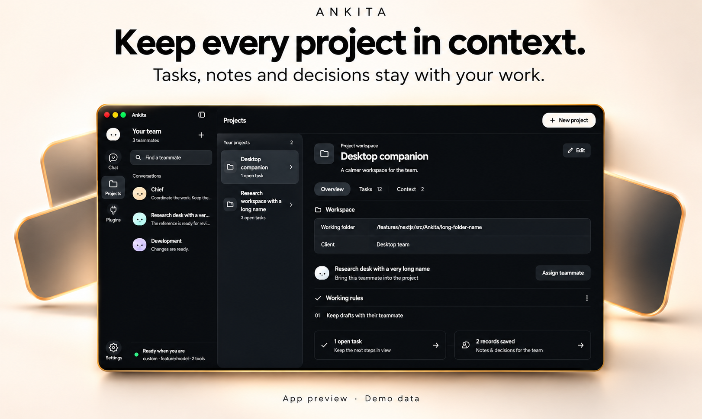
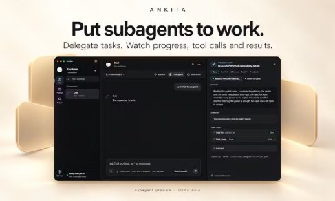

# 🤖 Ankita AI

[](https://github.com/akyourowngames/A.N.K.I.T.A/stargazers)
[](https://github.com/akyourowngames/A.N.K.I.T.A/releases/latest)
[](LICENSE)
[](https://github.com/akyourowngames/A.N.K.I.T.A/releases/latest)
[](https://github.com/NipunaRanasinghe/awesome-ai-agents/blob/main/EMERGING.md)

**Ankita AI is a personal AI companion for your desktop, built by Krish Verma** — open-source (MIT), local-first, your models. A little companion, a lot more possible: chat, files, terminal and browser tools together, with a floating companion that shows what your assistant is doing.

[Get Ankita for Windows](https://github.com/akyourowngames/A.N.K.I.T.A/releases/latest)
 · [Ankita website](https://ankita-sable.vercel.app)
 · [Release notes](CHANGELOG.md)
 · [Contributing](CONTRIBUTING.md)
 · [MIT license](LICENSE)

> How it was built: [How I built a 4-tier approval gate for my AI companion: a heuristic that can never say no](https://dev.to/krish_verma_77e28d3fd63ca/how-i-built-a-4-tier-approval-gate-for-my-ai-companion-a-heuristic-that-can-never-say-no-2k7o) — the write-up behind Ankita's safety model.

> Featured on [AI Business](https://aibusiness.vc/startups/ankita-free-open-source-desktop-ai-companion-windows): "Ankita: A Free, Open-Source AI Companion for Windows That Asks Before It Acts and Can Undo What It Did"

🆕 **Latest: v2.7.6 (27 Nov 2026)** — pseudonymous daily install metrics, reliable workspace shell starts, persistent personality and task skills, and computer-use screenshot verification. Full history in [CHANGELOG.md](CHANGELOG.md).

## 📸 App overview



*Projects workspace — app preview with demo data.*



*Subagent preview — app preview with demo data.*

## ✨ What Ankita does

- 💬 **Chat that does the work** — say a request once and Ankita opens the app, sets up the workspace or runs the job, then tells you when it is done. Replies stream as Markdown with code, tables and tool cards, and you inspect a command or file diff before approving it.
- 🎙️ **Voice that stays open** — after an answer, Ankita keeps listening for 25 seconds, so a follow-up needs no wake word; saying stop or cancel interrupts a reply. Long jobs get spoken progress updates and a completion report.
- 🛡️ **Approval first, undo always** — every action sits behind four tiers of approval, checked on every click, and destructive actions can be undone. Safe to leave running, not just clever in a demo.
- 🧠 **Memory that argues back** — near-duplicates update the existing fact instead of doubling it, and a contradiction gets flagged for you instead of quietly overwriting what was there.
- 📱 **Phone continuity** — continue a desktop job from your phone's browser with a pairing code that expires in two minutes. Only four files are allowed through that channel, and nothing installs on the phone.
- 🗂️ **Projects in context** — each project keeps its folder, working rules, tasks, notes and decisions together, with a work-review view for Git changes, diffs and recent artifacts.
- 🤖 **Subagents** — delegate tasks to sub-agents, watch their progress, tool calls and results, and keep going while earlier work runs.
- 🔌 **Channels & plugins** — Telegram, Discord and Slack in Settings → Channels, MCP servers and Composio apps in Plugins, and a ChatGPT tab route for people who already pay for ChatGPT. Fresh installs start on Kilo's keyless free models — no API key needed.

Telegram/Discord/Slack channels and voice delegation are source-branch work — see the [channel guide](docs/guides/channels.md) and [voice guide](docs/guides/voice-delegation.md) for setup and limits.

## 🖥️ Three ways in

| Surface | Use it for |
| --- | --- |
| **Desktop workspace** | Conversations, file review, projects, connected apps and settings |
| **Floating island** | Quick chats, approvals and live tool activity while the main window is hidden |
| **Terminal CLI** | Interactive coding, one-shot prompts, pipelines and background automation |

They use the same agent runtime and tools. Desktop teammates have separate threads, personas and drafts; assign a project to give a teammate its working folder and shared context.

## ⬇️ Install the Windows app

1. Open the [latest release](https://github.com/akyourowngames/A.N.K.I.T.A/releases/latest).
2. Download the **setup-x64.exe** to install Ankita, or **portable-x64.exe** for a standalone copy.
3. Open Ankita, choose your provider in **Settings → Providers**, and create a teammate. Fresh desktop installs start with Kilo's keyless free models; availability and rate limits depend on the provider. Existing choices remain.
4. With GitHub Copilot selected, follow the GitHub device sign-in shown by the app. For a custom provider, enter its API base URL and credentials in Settings.

The installer includes the application runtime; Node.js is only needed to run from source. Installed NSIS builds support in-app updates. Portable builds are updated by downloading a newer executable. Windows x64 is the published target; macOS/Linux packaging targets are declared, but this release is verified on Windows.

<details>
<summary>🖱️ Set up webpage capture</summary>

The capture helper is included in the desktop package and must be loaded into your browser separately:

1. Open **Browser helper** beside the desktop mascot or in the island's settings.
2. Choose **Open helper folder**.
3. On Chrome/Edge's Extensions page, enable Developer mode, choose **Load unpacked** and select that folder.
4. Use **Copy pairing code** in Ankita and paste it into the helper popup.
5. Drag a mascot onto an HTTP/HTTPS page. Review the captured attachment in chat.

The helper extracts readable document text. Browser-internal pages, extension stores and inaccessible frames/viewers cannot be captured. Details and recovery steps are in the [companion guide](docs/guides/desktop-companion.md#webpage-capture-and-responsiveness--2026-10-05).
</details>

## 🧰 Tools

| Tool family | Capabilities |
| --- | --- |
| Files and code | Read, write, edit, patch, list, glob and search files |
| Commands and processes | Run commands, inspect ports, manage processes and background jobs |
| Git and HTTP | Repository operations and structured requests |
| Web and browser | Search, readable page extraction, browser actions, tabs and screenshots |
| Phone | See an Android phone screen, tap, type, open apps, screenshot and read logs |
| Projects and memory | Working context, decisions, tasks and personal facts |
| Automation | Scheduled prompts, page watches and job control |
| Images | Original generation, Unsplash search and Pixabay search |
| Connected apps | MCP servers and Composio integrations |

Deferred tool families load when needed. Approval rules depend on the action; MCP/Composio tier controls cover auto-allow, ask-once, always-ask and deny. See [`tools/catalog.mjs`](tools/catalog.mjs) for the available families.

## ⌨️ Quick reference

| Desktop shortcut | Action |
| --- | --- |
| `Ctrl+K` / `Cmd+K` | Search commands, skills and scheduled tasks |
| `Ctrl+,` / `Cmd+,` | Open settings |
| `Enter` / `Shift+Enter` | Send / insert a newline |
| `Escape` | Close the active palette or dialog |
| Arrow keys / Home / End | Navigate project tabs when the tab has focus |

```bash
ankita -p "Summarize this repository"      # one-shot request
ankita --continue                        # resume the autosaved session
ankita --list-models                      # available models
ankita --voice                            # hands-free mode
ankita --daemon                           # background automation
```

Use `/help` for the current command list and `/commands` for the full grouped cheatsheet (every command, subcommand and tab-completion comes from one registry). Flags such as `--model`, `--max-tokens`, `--api-base`, `--api-key`, `--no-tools`, `--plain` and `--json` configure CLI runs.

## 🛡️ Safety & privacy

- **Four approval tiers, on every click** — destructive actions can be undone.
- **Memory that flags contradictions** instead of silently overwriting them.
- **Secret scrubbing is on by default** for supported key/token shapes, labeled passwords and private-key blocks in saved history, logs and exports. A live model request can still receive pasted content.
- **Required usage reporting in this build** — once a day, Ankita sends a stable hash of a random install ID, app version, operating system, and UTC day so the owner can count installs and recognize the same install over time. This pseudonym does not tell the owner who is using the install. It sends no name, account, prompts, file paths, or chat content; the receiving service may process connection details such as IP address. Older installed versions do not change until updated to 2.7.6. See [`docs/heartbeat.md`](docs/heartbeat.md).
- **Workspace boundaries** on file tools; web tools guard private hosts and redirects.
- **Credentials live in the device-encrypted vault**, never as plaintext. Approved shell commands and MCP processes run with your OS permissions — review requested actions before approving them.

## 🛠️ Run from source

The CLI supports the Node ranges declared in [`package.json`](package.json): Node 20.19+, 22.12+, or 23+. Use Node 22.12+ for desktop development/packaging. The following commands run from the repository root.

```bash
git clone --branch ankita https://github.com/akyourowngames/A.N.K.I.T.A.git
cd A.N.K.I.T.A
npm ci
```

```bash
npm run desktop:dev        # desktop in development
npm run desktop:build      # build the production renderer
npm run desktop:start      # open the production renderer
npm link && ankita         # start the CLI
```

Copy [`.env.example`](.env.example) to `.env` and configure the CLI provider. On PowerShell use `Copy-Item .env.example .env`; on a POSIX shell use `cp .env.example .env`. A global `config.env` is also supported under the configuration directory (`~/.copilot-chat-cli` by default, overridable with `CONFIG_DIR`). Desktop settings take priority over `.env` for desktop sessions. Voice features optionally need `ffmpeg`/`ffplay`; the optional stealth scraping tier uses Python and Scrapling.

## 🧪 Development

```bash
npm test                               # serial node:test suite
npm run desktop:build                  # TypeScript and production renderer
node scripts/verify-desktop-workbench.mjs
node scripts/verify-desktop-island.mjs
node scripts/verify-desktop-companion-native.mjs
```

Desktop checks use isolated fixture configuration and temporary evidence folders. See the guides for measured results and uncovered platforms/workloads.

```text
desktop/electron/       windows, IPC, agent hosting, capture, vault and scheduler
desktop/renderer/       React workspace, companion, readers and live tool UI
desktop/browser-helper/ Chrome/Edge capture extension
desktop/shared/         typed contracts, state and interaction helpers
src/                    CLI, agent, providers, automation, channels and memory
tools/                  core and deferred tool families
skills/                 built-in chat skills
test/                   subsystem regression suites
scripts/                live verification and development utilities
```

Local packaging: `npm run desktop:package:win`. Release workflow, update assets and required gates are documented in [Releasing](docs/guides/releasing.md). Third-party companion attribution ships in [`desktop/THIRD_PARTY_NOTICES.md`](desktop/THIRD_PARTY_NOTICES.md).

## 📚 Docs & contributing

- [Desktop workspace](docs/guides/desktop-workbench.md)
- [Companion, file drops and webpage capture](docs/guides/desktop-companion.md)
- [Phone pairing](docs/guides/phone-pairing.md)
- [Controlling an Android phone](docs/guides/phone-control.md)
- [Browser connections and permissions](docs/guides/browser-use.md)
- [Scheduled desktop jobs](docs/guides/desktop-jobs.md)
- [Release and auto-update](docs/guides/releasing.md)
- [Release history](CHANGELOG.md)
- [Contribution guide](CONTRIBUTING.md)

First community skill: the [codebase-tour skill](skills/codebase-tour/SKILL.md) was contributed by [Pradyumna Parida (@Pradyumna-red)](https://github.com/Pradyumna-red) in [PR #69](https://github.com/akyourowngames/A.N.K.I.T.A/pull/69).

Read [AGENTS.md](AGENTS.md), preserve existing work and include execution evidence with changes. Contributions target the `ankita` branch.
